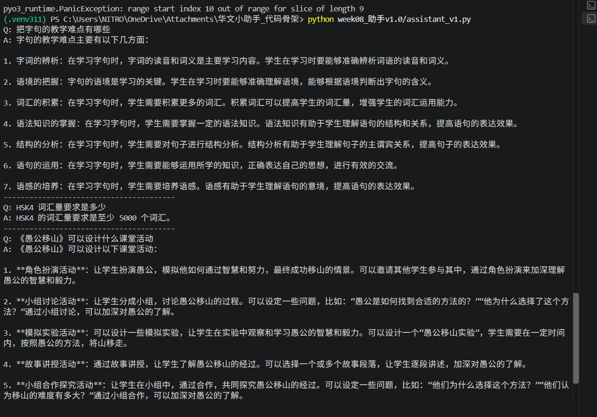
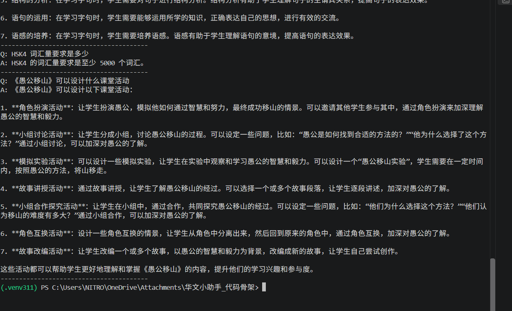

# 第8周作业：学科智能问答助手 v1.0

姓名：陈佳怡  
学号：L25000016

## 一、项目介绍
本项目是一个学科智能问答助手，主要帮助学生学习汉语知识。

## 二、主要功能
1. 使用第6周的双引擎进行问答。
2. 结合第7周的RAG知识库检索。
3. 支持汉语教学相关问题。
4. 本地模型优先，失败时尝试云端模型。

## 三、运行方法
在项目根目录运行：

```bash
python week08_助手v1.0/assistant_v1.py
```

## 四、测试结果
程序已成功运行，并回答了三个问题：

1. 把字句的教学难点有哪些？
2. HSK4词汇量要求是多少？
3. 《愚公移山》可以设计什么课堂活动？

三个问题均获得了回答。

## 五、学习总结
通过本周学习，我了解了如何将双引擎和RAG知识库结合起来，制作一个简单的汉语学习助手。

## 六、运行结果截图

以下是本项目的实际运行结果。

### 运行截图一


### 运行截图二


